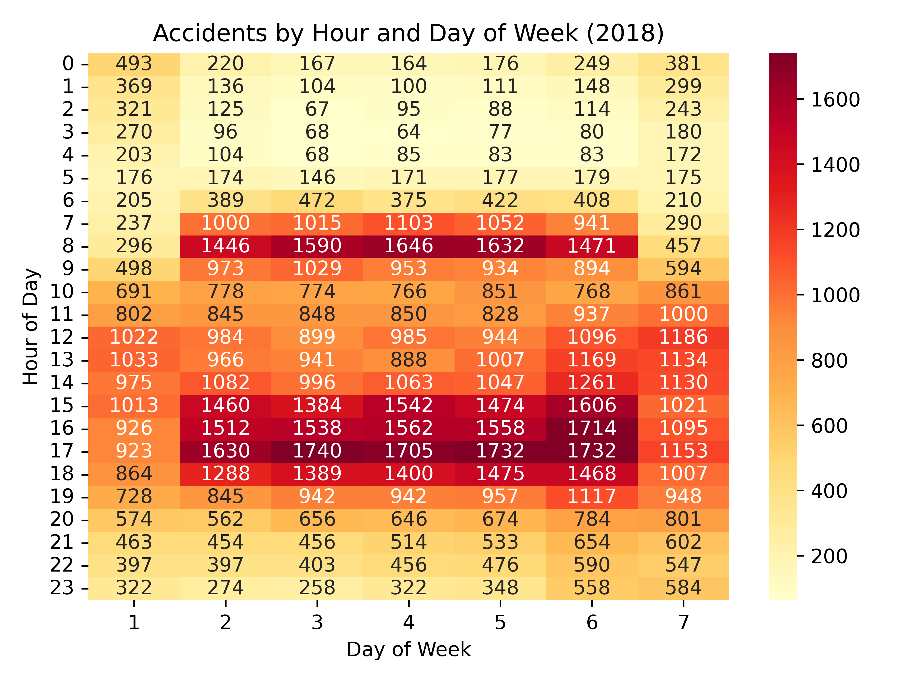
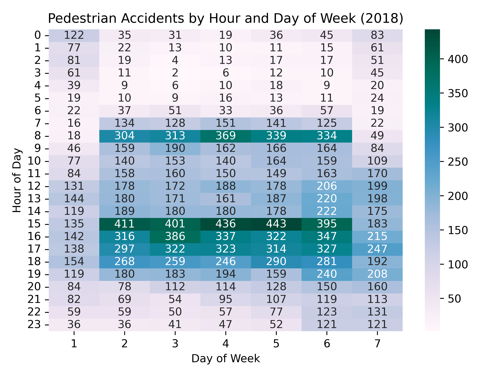
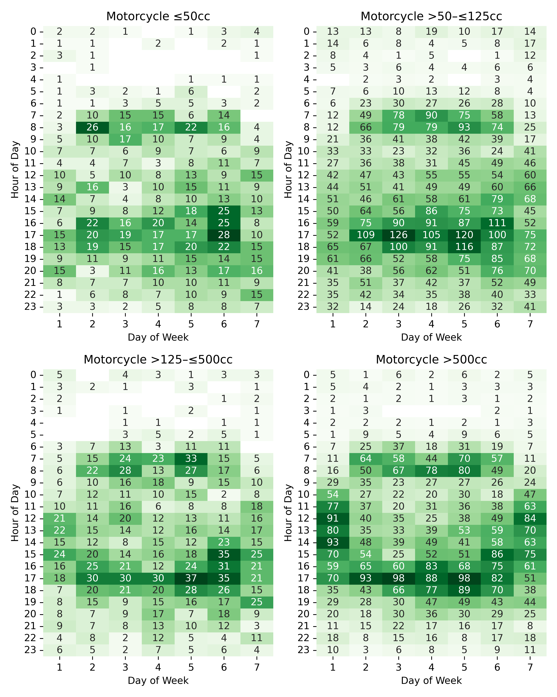
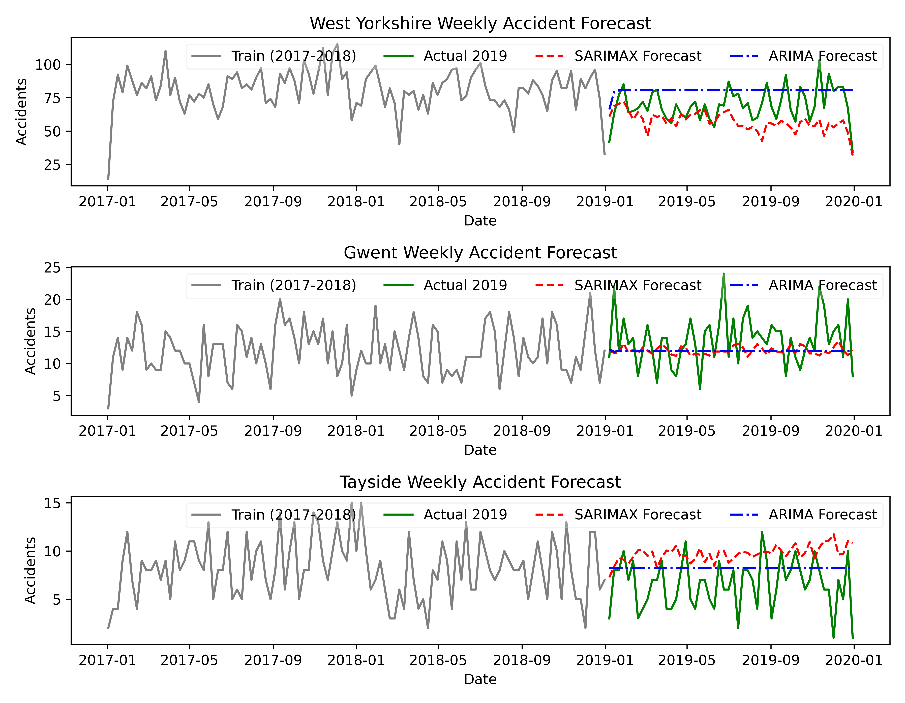

# Traffic Accident Analysis

A data-driven exploration of UK road accidents that reveals *when* and *where* crashes happen, and uses statistical forecasting to help safety agencies target their resources where they matter most.

Built with Python and the **STATS20** accident dataset, this project combines time-series forecasting, association-rule mining, and geographic clustering to turn raw accident records into actionable road-safety insights.

## What This Project Does

Starting from a single SQLite database, the analysis runs through seven connected stages:

- **When accidents happen** — maps accident frequency across the hours of the day and days of the week.
- **Motorcycle accidents** — breaks down crashes by engine size to spot recreational vs. commuter riding.
- **Pedestrian accidents** — isolates foot-casualty patterns and links them to traffic peaks.
- **Association rules** — uses Apriori to find which road, weather and location conditions lead to *slight*, *serious*, or *fatal* outcomes.
- **Geographic clustering** — groups West Yorkshire accidents into hotspots using K-Means, Gaussian Mixture, and Agglomerative methods.
- **Regional forecasting** — predicts weekly accident counts for three police forces (England, Wales, Scotland).
- **Hyper-local forecasting** — forecasts daily accident counts for the 30 busiest LSOAs in West Yorkshire.

## Key Findings

- **Timing.** The busiest accident windows are the morning (07–09) and late-afternoon (15–18) commute peaks, with **Friday** consistently the highest-count weekday.
- **Motorcycles vs. pedestrians.** Both groups follow the same traffic-driven rhythm, but motorcycles over 500cc show a distinct midday bump on weekends — a signature of recreational riding.
- **Weather & road surface.** Wet/damp roads combined with rain and urban settings reliably produce *slight*-severity collisions rather than fatal ones.
- **Hotspots.** Clustering confirms that accidents concentrate around cities — **Leeds** appears as a distinct cluster in every method.
- **Forecasting.** Seasonal **SARIMAX** models track the weekly cycle better than a plain ARIMA baseline.

## Images

<table style="width: 100%; border-collapse: collapse;">
  <tr>
    <td style="border: 1px solid #ddd; padding: 10px; text-align: center;">
      
    </td>
    <td style="border: 1px solid #ddd; padding: 10px; text-align: center;">
      
    </td>
  </tr>
  <tr>
    <td style="border: 1px solid #ddd; padding: 10px; text-align: center;">
      
    </td>
    <td style="border: 1px solid #ddd; padding: 10px; text-align: center;">
      
    </td>
  </tr>
</table>

*More visualisations are available in the `assets/` folder, including cluster diagnostics, the West Yorkshire cluster maps, the LSOA July forecast, and the remaining per-category heatmaps.*
